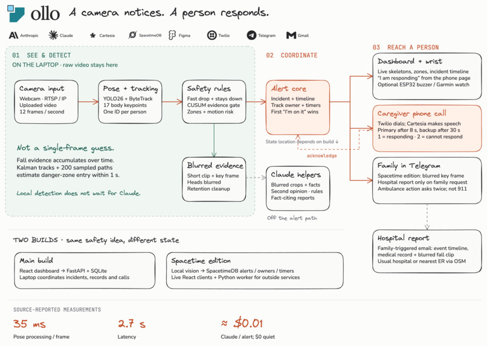

<div align="center">
  
  <h3>ollo watches the cameras you already have. When someone falls, it reaches the people who can help and keeps trying until one of them says "I'm on it."</h3>
  Built at Cal Hacks 13.0
</div>

## What it does

1. **Sees the fall.** Pose tracking flags a fall about 3 seconds after it happens.
2. **Calls.** A Cartesia voice calls the caregiver, says what it saw, and asks if they can check. If they don't answer, it calls the backup.
3. **Gives the alert one owner.** The caregiver taps "I'm on it" on the dashboard, their phone, the wrist buzzer or their Garmin watch. The pending call is hung up and everyone else sees who is handling it.
4. **Messages the family.** A phone call and a Telegram alert with a blurred frame, the room, and what to do next.
5. **Helps the family act.** Two taps call an ambulance. One tap emails her medical record, the fall clip and the timeline to her usual hospital, or the nearest ER.
6. **Keeps the record.** Each incident has a timeline: detected, messaged, called, acknowledged, resolved.



## Why it matters

In one study of people over 90 who fell, 30% stayed on the floor for an hour or more ([BMJ 2008](https://www.ncbi.nlm.nih.gov/pmc/articles/PMC2590903/)). ollo cuts that wait to seconds, and her record reaches the hospital before she does.

## How we built it

- **Vision:** Ultralytics YOLO26 pose with ByteTrack and OpenCV, on the laptop. A fall is a fast drop followed by lying still, so sitting down doesn't count.
- **SpacetimeDB** holds the alerts, who owns each one, and the escalation timers. Every update runs as a transaction inside the database and is pushed straight to every subscribed screen, with no separate API server or polling. The dashboard, phone, wrist buzzer and watch update the moment an alert opens. If two caregivers tap "I'm on it" at the same time, exactly one gets it.
- **Cartesia** gives the call its voice. It explains what the camera saw and where, so a caregiver who isn't looking at a screen still knows what to do. Its voice agent understands a spoken "I'm on it". **Twilio** dials while Cartesia generates the speech, so the call isn't held up waiting for the audio.
- **Claude** (Anthropic) runs only after an alert, so it costs about a cent per fall and nothing when the room is quiet. It takes a second look at a blurred crop of the person and returns a structured opinion that can lower the urgency of a low-priority alert. It can never cancel one, which cuts noise without risking a missed fall. It also turns typed rules ("keep kids away from the kitchen gate") into zones and writes incident reports in which every line cites a logged fact.
- **Telegram** carries the family alert and its ambulance and hospital-report buttons.
- **React** dashboard and phone view, an **ESP32** wrist buzzer, a **Garmin Connect IQ** watch app, and a logo designed in **Figma**.

## Two builds in this repo

| | Main app (Fallback) | Spacetime edition (Recommended) |
|---|---|---|
| Folders | `server/`, `src/` | `spacetime/`, `vision/`, `worker/`, `web/`, `firmware/`, `garmin/` |
| Backend | FastAPI + SQLite | SpacetimeDB + a Python worker |
| Shows off | Calls to a real phone, Claude rules and reports, uploaded videos analyzed frame by frame | Telegram family alerts, ambulance and hospital report, wrist buzzer, Garmin watch |
| Start here | [Run it](#run-it) below | [README.spacetime.md](README.spacetime.md) |

## Run it

Needs Node 20.19+ and Python 3.12.

```sh
npm install
python3.12 -m venv .venv
.venv/bin/python -m pip install -r server/requirements.txt -r server/requirements-pose.txt
npm run models
npm start
```

Open http://127.0.0.1:5173, then upload a clip, use your webcam, or add an RTSP camera under Settings → Manage source.

Without keys, calls are simulated and labeled as such. For real calls, copy `.env.example` to `.env`, add your Twilio and Cartesia keys, and arm calls in the app. Only call people who agreed to it.

## Tests

```sh
.venv/bin/python -m pytest server/tests -q                  # main app
cd worker && .venv/bin/python -m pytest -q                  # Spacetime worker
npm run test:skeleton && npm run test:catchup && npm run test:media
```

Each requirement in [docs/SPEC.md](docs/SPEC.md) and [CLUADE.md](CLUADE.md) names its test. The math behind the fall rule and the cost numbers is in [docs/MATH.md](docs/MATH.md).

## Limits

- ollo flags a *possible* fall for a person to check. It doesn't diagnose medical condition.
- The pose model sometimes loses people lying flat on the floor, and it needs at least 6 frames per second.
